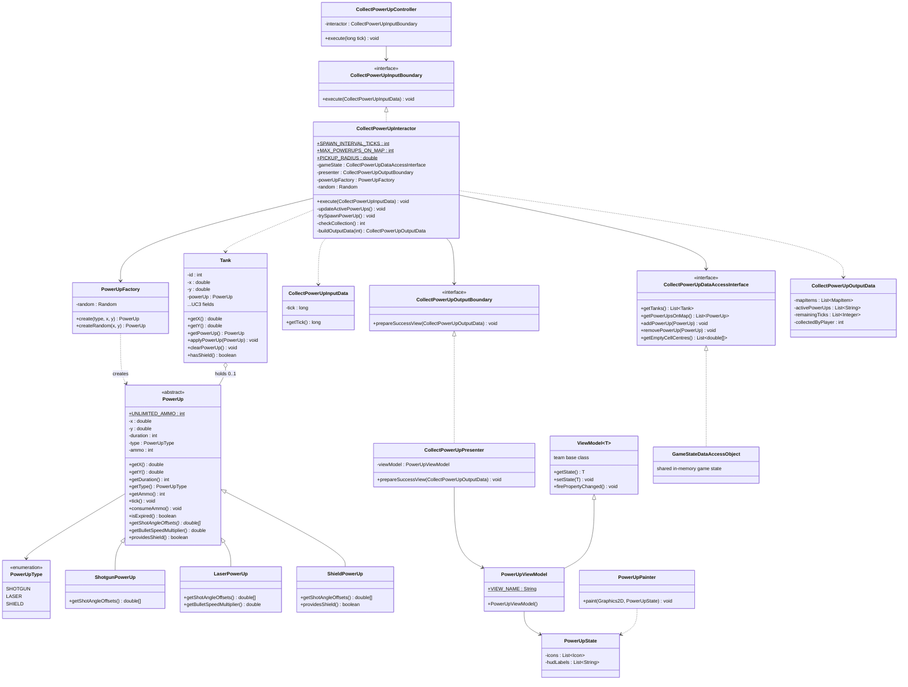

# UC4 – Collect Power-Up (design)

## Workflow (runs once per game tick, called from the game loop)

1. **Game loop** (UC3's Swing `Timer`) calls `CollectPowerUpController.execute(tick)`.
2. Controller wraps the tick in `CollectPowerUpInputData` and calls the interactor through `CollectPowerUpInputBoundary`.
3. `CollectPowerUpInteractor.execute`:
   1. `updateActivePowerUps()` counts down each held power-up; if expired (time or ammo), `tank.clearPowerUp()` → normal weapon. *(alt flow 2)*
   2. Every `SPAWN_INTERVAL_TICKS`, `trySpawnPowerUp()` picks a random empty cell (not near a tank or another power-up) and asks `PowerUpFactory` for a random power-up. Skipped if `MAX_POWERUPS_ON_MAP` already reached. *(main step 1, alt flow 3)*
   3. `checkCollection()` checks whether a tank is within `PICKUP_RADIUS` of a power-up: if so, removes it from the map and gives it to the tank with `tank.applyPowerUp(p)`, replacing any held one. *(main steps 2–3, alt flow 1)*
   4. Builds `CollectPowerUpOutputData` and calls `presenter.prepareSuccessView`.
4. `CollectPowerUpPresenter` formats HUD text (e.g. `Shotgun (8s)`) and icon positions into `PowerUpState`, then fires `PowerUpViewModel`. *(main step 4)*
5. The game panel redraws, calling `PowerUpPainter.paint(g, state)` and showing the HUD labels next to the scores.
6. When the player fires, UC3 asks the tank's `PowerUp` for `getShotAngleOffsets()` / `getBulletSpeedMultiplier()` and calls `consumeAmmo()`. *(main step 5)*

## Contract with other use cases

| Who | Needs to |
|-----|----------|
| UC3 – `Tank` | UC4 added `applyPowerUp`, `clearPowerUp`, `hasShield` (already in this PR) |
| UC3 – fire logic | If `tank.getPowerUp() != null`: one bullet per angle in `getShotAngleOffsets()`, speed × `getBulletSpeedMultiplier()`, then `consumeAmmo()` |
| UC3 – hit logic | If `tank.hasShield()`: ignore the hit |
| UC3 – game loop | Call `collectPowerUpController.execute(tick)` every tick |
| UC2 / shared DAO | Implement `CollectPowerUpDataAccessInterface`; clear power-ups when a new round starts |

## Design choices

- **Clean Architecture**: entities ← use case ← interface adapters ← view; the interactor only knows interfaces.
- **Open/Closed + Strategy**: a new power-up = one new `PowerUp` subclass and one line in `PowerUpFactory`.
- **Factory**: `PowerUpFactory` is the only class that knows the concrete power-up types.
- **Dependency Inversion**: the interactor depends on `CollectPowerUpDataAccessInterface`, not on a concrete DAO.
- **Observer**: `PowerUpViewModel` extends the team `ViewModel<T>` and notifies `GameView` on change.

## Class diagram

